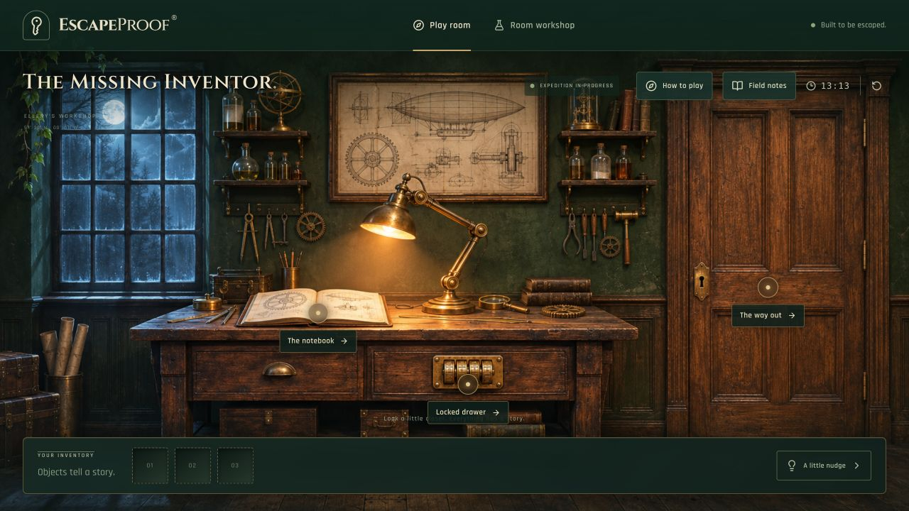

# EscapeProof

**Every room has an escape. We checked.**

A full-screen browser escape room with realistic workshop artwork and an operator workshop for the KaneCLI hackathon. Codex develops the application; Kane drives the actual browser to verify the game. An optional runtime authoring agent generates and repairs structured room data using Meta Muse through Meta Model API.



## Run locally

Requires Node.js 24.11.1 or later and npm.

```bash
npm ci
cp .env.example .env # Skip if .env already exists.
# Set OPERATOR_TOKEN to a long random value in .env.
npm run dev
```

Open **http://127.0.0.1:5173**. The Vite frontend proxies `/api` to Fastify on port 3001. The original handcrafted room works without AI or TestMu credentials. Set your own long, random `OPERATOR_TOKEN` in `.env`, then use it in **Room workshop**. Never commit `.env`.

For a production-style local preview:

```bash
npm run build
APP_ORIGIN=http://127.0.0.1:3001 npm start
```

Stop the development server first if port 3001 is occupied. Preview at http://127.0.0.1:3001.

## Enable live integrations

1. Register for TestMu AI and claim hackathon credits using the same registration email.
2. Install Kane and Chrome:

```bash
npm install -g @testmuai/kane-cli@0.10.4
kane-cli --version
kane-cli login
```

Install Google Chrome, or set `KANE_CLI_CHROME_PATH` to its executable. The adapter also detects a checkout-local Chrome installation when available.

3. Add your Meta `MODEL_API_KEY` to `.env` to enable generation and repair. `MUSE_MODEL` defaults to `muse-spark-1.3` and can be changed to another Muse model available to your Meta account. Runtime API usage may incur charges; configure this only when you intend to use it.
4. Restart the server after changing environment variables.
5. Run `npm run kane:smoke`. It stores genuine output under `data/smoke-evidence/` and reports an infrastructure error if Kane cannot authenticate or run. A failed setup check is not a puzzle failure.

Kane authentication stays in its own profile. The app does not expose or ask visitors for provider credentials. Operator sessions expire after eight hours and are invalidated on server restart.

## Play and operate

- **Play room:** read the opening guide, begin the expedition, inspect the glowing object markers, read the notebook, open the combination drawer, collect the key, and use it on the door. Hints are progressive; restarting resets progress and the timer.
- **Room workshop:** sign in with `OPERATOR_TOKEN`, generate a draft or select the handcrafted original, preview, verify, and publish only after both checks pass.
- **Fault injection:** expand Developer fault injection and remove the required clue. This creates a new immutable revision. Kane should fail the clue check; with live AI configured, genuine failure evidence feeds a repair and a rerun.
- No room is automatically published. Operator publication changes the version served to new public player sessions. Existing sessions stay pinned to their original revision.
- When nothing is published, public visitors receive the clearly labeled handcrafted fallback. It is never presented as Kane-verified.

## Architecture

```text
React player / workshop → Fastify API → SQLite
                                 ↓
                      one background verification worker
                                 ↓
                    Kane CLI → isolated Chrome profile
                                 ↓
                    event stream + sealed evidence
                                 ↓
                   repair agent → new immutable revision
                                 ↓
                       rerun both checks → publish gate
```

`server/room.ts` owns the private room schema, dependency validation, action transitions, and public projections. Only visited clues are revealed to players; answers, dependencies, and intended solutions never enter the frontend bundle or public room metadata. Four-digit combinations are checked on the server.

`server/store.ts` stores immutable revisions, sessions, one-time preview tickets, jobs, checks, and events in SQLite. A database trigger prevents revision mutation. Verification is attached to a revision ID and content hash. Publication requires both checks on the same revision in the same successful job; creating a revised draft carries no verified status.

Preview tickets are redeemed once and bound to the first signed player session. Revisiting the URL in that same browser resumes the session; other browsers cannot reuse it. This handles Kane's initial page load followed by its navigation step without sharing draft access across runs.

`server/worker.ts` processes one job at a time with at most three active/queued jobs and at most two repairs per job. Every browser check gets a new one-time preview ticket and a new Chrome profile. It checks:

1. **Clue availability:** the notebook must expose a meaningful clue with four ordered quantities; the objective receives no secret answer.
2. **Intended solution:** the browser performs the full player interaction sequence and confirms the escape screen.

`server/kane.ts` starts Kane using argument arrays, bounds run time and steps, parses its real NDJSON stream, checks exit codes and terminal events, and retains output and available sealed `.evidence` packs. Authentication, browser, upload, timeout, and incomplete-run errors never automatically trigger puzzle edits. Only confirmed bugs or failed UI assertions are eligible for repair.

`server/ai.ts` calls Meta Muse at `https://api.meta.ai/v1` through the API-compatible OpenAI SDK client. No OpenAI service or OpenAI key is used. Repair prompts include the original requirements, failed room, real failure summary, and step events. Repairs must preserve the code, puzzle dependencies, item placement, and solution sequence. Before/after clue text and changed fields are visible to operators. A maximum of two repairs prevents unbounded use.

Progress reaches the operator through Server-Sent Events; missed connections reload the saved snapshot. Evidence downloads require operator authentication and never grant public access to the private solution.

**Verification means the intended route works and required clues can be accessed. It does not prove fairness, universal solvability, or absence of every shortcut.** Clue semantics are evaluated by Kane; structural graph validation alone cannot prove a human can infer an answer.

## Persistence and Docker

`DATA_DIR` defaults to `./data`. Back up the whole directory, including the SQLite WAL files, using a SQLite-aware backup or after stopping the server. It also holds the persistent cookie-signing secret and private evidence. Do not publish it with the source repository.

```bash
docker compose up --build -d
docker compose exec app kane-cli login
docker compose logs -f app
```

Open http://127.0.0.1:3001. Named volumes retain SQLite/evidence and the Kane profile. The Dockerfile targets Linux amd64 because it installs Google's amd64 Chrome package. It runs the application as the non-root `node` user with shared memory provided by Compose. If OAuth cannot launch a browser from the container, consult `docker compose exec app kane-cli login --help` for Kane's basic-auth login options; keep credentials private.

For remote hosting, set `APP_ORIGIN` to the exact reachable application origin, enable HTTPS, set `COOKIE_SECURE=true`, and configure persistent storage. The verification worker must reach this origin. Do not deploy this long-running Chrome worker to a request-only/serverless runtime. No external deployment is performed automatically.

## Checks

```bash
npm run typecheck
npm test
npm run build
npm run kane:smoke
```

With both integrations configured, `APP_ORIGIN=http://127.0.0.1:3001 npm run demo:live` runs the genuine local acceptance demonstration: Muse generation, deliberate missing-clue injection, Kane failure, bounded repair, both checks, local publication, and a fresh public browser escape without supplying the answer. It uses provider credits and publishes only inside the local application. Existing generated/faulty revisions can be reused by setting `DEMO_GENERATED_REVISION_ID` and `DEMO_FAULTY_REVISION_ID`, avoiding unnecessary regeneration after a setup error. The script fails instead of claiming success if any required stage does not complete.

Tests cover game transitions, private data boundaries, graph validation, immutable revisions, publication gates, isolated sessions, one-time tickets, queue/repair limits, operator access, and infrastructure classification. Test fixtures are not live Kane evidence.

See [demo script](docs/DEMO.md), [submission checklist](docs/SUBMISSION.md), and [verification record](docs/VERIFICATION.md).

Official references: [hackathon](https://www.kaneclihack.sh/), [Kane agent output](https://www.testmuai.com/docs/kane-cli-agent-mode), [Kane installation](https://www.testmuai.com/docs/kane-cli-installation), [Meta quickstart](https://dev.meta.ai/docs/quickstart), [Meta structured output](https://dev.meta.ai/docs/structured-output).

## Hosted app

Play or open the protected workshop at https://escapeproof.vercel.app. Vercel serves the website and proxies `/api` to the Railway backend, where Meta Muse generation and Kane CLI verification run with persistent SQLite and evidence storage. Use your configured operator token to enter the workshop. See [deployment details](docs/DEPLOYMENT.md).

The standalone handcrafted demo API remains available as a fallback implementation, with authenticated encryption for progress cookies and private server-side answers. To use it without Railway, set `DEMO_SESSION_SECRET`, build with `VITE_PUBLIC_DEMO=true`, and route `/api/:path*` to `/api/demo?route=:path*`.
